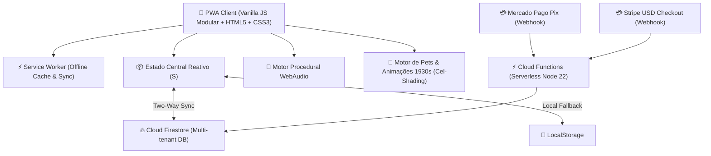

# 🏛️ Arquitetura do Prumo (Enterprise Architecture & Technical Specification)

> Documento oficial de engenharia, arquitetura de software e governança técnica da plataforma **Prumo**.

---

## 1. Visão Geral da Arquitetura

O **Prumo** é um Progressive Web Application (PWA) de alto desempenho, com arquitetura **Offline-First, Zero-Cold-Start e Custo Fixo de Infraestrutura Zero** baseada no ecossistema Google Cloud / Firebase.

---

## 2. Pilares de Engenharia

### 2.1. Arquitetura Modular e Vanilla (Zero-Dependency Overhead)
- **Zero Framework Churn:** Diferente de apps construídos em React/Next.js que sofrem depreciação de bibliotecas a cada 6 meses, o Prumo foi construído sobre padrões W3C perenes (DOM nativo, Web Components conceituais e ES6+).
- **Desempenho Extremo:** Carregamento instantâneo, renderização a 60 FPS e baixo consumo de bateria em smartphones.
- **Tamanho do Bundle:** Menos de 400 KB no carregamento inicial (Gzip/Brotli).

### 2.2. Modelo de Estado e Persistência
- Objeto de estado reativo único `S` contendo:
  - `tasks`: Tarefas diárias com repetições, prazos e áreas de foco.
  - `habits`: Hábitos diários com tracking semanal e sequências.
  - `livros`: Estante virtual com histórico de páginas lidas e metas.
  - `pets`: Sistema de mascotes com humores, fome, carinhos e truques.
  - `persona`: 17 identidades visuais e sonoras com temas exclusivos.
  - `pro`: Estado de licença e benefícios comerciais.
- Função atômica `commit()`: Salva em `LocalStorage` e despacha sincronização diferencial com o Firestore.

### 2.3. Motor de 17 Mundos & Gamificação
- Sistema desacoplado em `js/mundos/` onde cada persona (Feiticeiro, Bruxo, Zen, Rock, Emo, Otaku, etc.) injeta:
  - Paleta de cores dinâmica e tokens CSS (`--accent`, `--bg`, `--ink`).
  - Paisagens sonoras no WebAudio (chuva, fogo, sintetizadores lo-fi).
  - Itens de vestuário e cosméticos com atributos no mascote Prumi.

### 2.4. Motor de Pets e Shaders Estilo Anos 1930 (Cuphead/Fleischer)
- Camadas em SVG e texturas analógicas de papel e guache.
- Ciclos de animação interpolados para *Idle*, *Walk*, *Sleep*, *Eat* e *Petting*.
- Deformação elástica (*Rubber Hose Squash & Stretch*) orientada a física temporal.

---

## 3. Segurança e Conformidade (LGPD & Security Grade A+)

1. **Content Security Policy (CSP):** Rigorosa, bloqueando qualquer injeção inline maliciosa (`script-src 'self'`).
2. **Strict-Transport-Security (HSTS):** Forçado em todas as rotas com `max-age=31536000; includeSubDomains; preload`.
3. **Proteção de Iframe:** `X-Frame-Options: DENY` eliminando riscos de *Clickjacking*.
4. **Regras do Firestore (`firestore.rules`):**
   - Usuários só lêem e escrevem seus próprios documentos (`request.auth.uid == userId`).
   - Coleção `licencas/` só pode ser alterada pelo servidor (Cloud Functions via chave de serviço).

---

## 4. Esteira de CI/CD e Garantia de Qualidade

A cada commit na branch `main`:
1. **Pipeline de Testes Automáticos:**
   - Checagem estática de colisões de escopo global (`testes/globais.js`).
   - 11.000+ linhas de testes unitários e de integração em ambiente JSDOM.
   - Emulador oficial do Firestore rodando testes de regras de banco.
2. **Pipeline de Publicação:**
   - Carimbo determinístico de versão (`?v=<sha>`).
   - Minificação automática de CSS e JS para máxima pontuação no SEMrush e Lighthouse.
   - Deploy automático no Firebase Hosting e Cloud Functions.
   - Smoke test automatizado em navegador Chromium real pós-deploy via Playwright.
