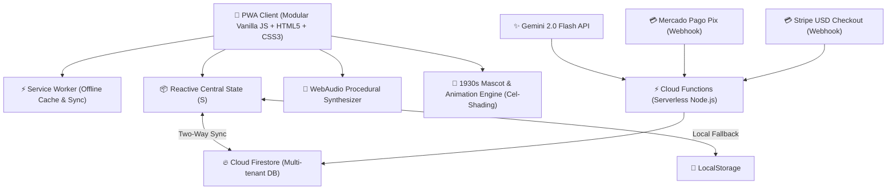

# 🏛️ Prumo Enterprise Architecture & Technical Specification

> **Official engineering, software architecture, and technical governance documentation for the Prumo platform.**

---

## 1. Architectural Overview

**Prumo** is a high-performance Progressive Web Application (PWA) built on an **Offline-First, Zero-Cold-Start, Zero-Fixed-Infrastructure-Cost** model leveraging the Google Cloud / Firebase serverless ecosystem.

---

## 2. Core Engineering Pillars

### 2.1. Modular Vanilla Architecture (Zero-Framework Churn)

- **Zero Framework Depreciation:** Unlike React/Next.js/Vue ecosystems requiring constant dependency maintenance and migration every 6 months, Prumo is engineered on immutable W3C standards (native DOM, conceptual Web Components, ES6+).
- **Extreme Performance:** Instant load times, consistent 60 FPS animations, and low battery consumption on mobile devices.
- **Micro Bundle Footprint:** Under 400 KB uncompressed initial load with instant local execution.

### 2.2. State Model & Persistence

- Single unified reactive state object `S` managing:
  - `tasks`: Daily tasks with recurrences, priority levels, and sub-items.
  - `habits`: Daily routines with weekly cadence tracking and protective streaks.
  - `books`: Virtual bookshelf with page tracking, goals, and reader achievements.
  - `pets`: Collectible mascot companions with moods, hunger, and interactive tricks.
  - `persona`: 17 visual and auditory identities with dedicated style tokens.
  - `cronogramaEdital`: Complete exam syllabus schedules divided into theory, question drills, and mock tests.
  - `pro`: Commercial license state and active entitlement verification.
- Atomic mutation function `commit()`: Persists locally to `localStorage` and triggers background differential synchronization with Cloud Firestore when authenticated.

### 2.3. 17 Aesthetic Worlds & Gamification Engine

- Modular architecture in `js/mundos/` where each persona (Wizard, Witch, Zen, Rocker, Emo, Otaku, Gamer, Programmer, etc.) provides:
  - Dynamic color palettes and CSS root tokens (`--accent`, `--bg`, `--ink`, `--surface`).
  - Procedural soundscapes via WebAudio (rain, crowd applause, vinyl crackle, 808 beats, chiptune arpeggios).
  - Collectible garments and equipment layers rendered on the Prumi SVG mascot.

### 2.4. 1930s Rubber-Hose Animation & Mascot Rigging

- Clean vector SVGs with analog paper and ink textures.
- Interpolated animation states for _Idle_, _Walk_, _Sleep_, _Eat_, and _Petting_.
- Time-based squash & stretch physics providing responsive character feedback without external animation runtimes.

---

## 3. Security, Privacy & Compliance (LGPD & Security Grade A+)

1. **Content Security Policy (CSP):** Strict whitelist blocking untrusted scripts and inline execution (`script-src 'self' https://www.gstatic.com`).
2. **Strict-Transport-Security (HSTS):** Enforced across all routes (`max-age=31536000; includeSubDomains; preload`).
3. **Frame Protection:** `X-Frame-Options: DENY` eliminating clickjacking vectors.
4. **Firestore Security Rules (`firestore.rules`):**
   - User document isolation (`request.auth.uid == userId`).
   - License records (`licencas/`) and global catalog collections are restricted to authenticated administrator roles or backend Cloud Functions service accounts.

---

## 4. Continuous Integration & Quality Assurance

Every push to `main` undergoes automated verification:

1. **Global Scope Collision Audit (`testes/globais.js`):** AST-level verification preventing any global identifier naming conflicts.
2. **50+ Integration Test Suites (`testes/rodar.js`):** Executed in headless JSDOM covering full functional workflows with 100% pass guarantee.
3. **Automated Deployment:** GitHub Actions automatically stamps the commit hash and deploys to Firebase Hosting and Cloud Functions upon green test status.
